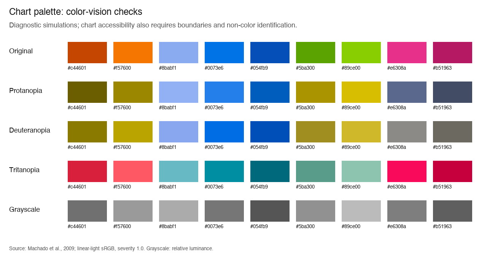

# Chart palette accessibility check

Follow-up: [November 11 rollout](chart-palette-rollout-2026-11-11.md) keeps solid fills and supplies equivalent readable values tables; the numeric limitations below still apply.

Checked 2026-11-10. **Decision: candidate colors retained; not approved for unrestricted use across all visualizations.**

## Scope and standard

The two user-provided sets contain nine unique colors; `#0073e6` appears in both. Checked their exact opaque sRGB values, the selected Overview Desktop Dark — Orange & Blue Charts canvas chart, and report-template.html for source backgrounds and existing chart accessibility provisions. The canvas chart uses `#171717`; the repository also defines `#262626` hover surfaces, `#ffffff` light surfaces, and `#f5f5f5` light secondary surfaces. No assumption that one color set is universally accessible. This is a chart-color audit, not a full website conformance assessment.

[WCAG 2.2](https://www.w3.org/TR/WCAG22/) is the current W3C Recommendation used for this assessment, targeting Level AA. [WCAG 3](https://www.w3.org/WAI/standards-guidelines/wcag/wcag3-intro/) remains a draft. APCA is not the conformance metric for WCAG 2.2.

- [1.4.3 Contrast (Minimum)](https://www.w3.org/WAI/WCAG22/Understanding/contrast-minimum.html): ordinary text requires 4.5:1; large text requires 3:1 (24 CSS px regular or approximately 18.67 CSS px bold).
- [1.4.11 Non-text Contrast](https://www.w3.org/WAI/WCAG22/Understanding/non-text-contrast.html): essential graphical boundaries require 3:1 against their actual adjacent colors, unless equivalent accessible information makes the graphic unnecessary for understanding. Non-overlapping lines do not universally need 3:1 against each other; touching stack segments do when their boundaries convey values.
- [1.4.1 Use of Color](https://www.w3.org/WAI/WCAG22/Understanding/use-of-color.html): provide another visible way to identify series, such as labels, patterns or symbols.

## Candidate bank and text pairings

All nine swatches pass AA ordinary-text contrast with the foreground shown. These foregrounds must be exact white or black: the result does not approve gray text, opacity changes, or every text color on the swatch. `#0073e6` also passes with black (4.59:1), but the user-specified white pairing is retained below.

| Candidate | Text on fill | Text ratio (4.5 minimum) | On dark #171717 | On hover #262626 | On white #ffffff | On secondary #f5f5f5 |
|---|---|---:|---:|---:|---:|---:|
| `#c44601` | White | 4.97:1 pass | 3.61 pass | 3.04 pass | 4.97 pass | 4.56 pass |
| `#f57600` | Black | 7.47:1 pass | 6.38 pass | 5.39 pass | 2.81 FAIL | 2.58 FAIL |
| `#8babf1` | Black | 9.19:1 pass | 7.85 pass | 6.62 pass | 2.28 FAIL | 2.10 FAIL |
| `#0073e6` | White | 4.57:1 pass | 3.92 pass | 3.31 pass | 4.57 pass | 4.19 pass |
| `#054fb9` | White | 7.43:1 pass | 2.41 FAIL | 2.04 FAIL | 7.43 pass | 6.82 pass |
| `#5ba300` | Black | 6.68:1 pass | 5.71 pass | 4.82 pass | 3.14 pass | 2.88 FAIL |
| `#89ce00` | Black | 10.89:1 pass | 9.30 pass | 7.85 pass | 1.93 FAIL | 1.77 FAIL |
| `#e6308a` | Black | 5.15:1 pass | 4.40 pass | 3.71 pass | 4.07 pass | 3.74 pass |
| `#b51963` | White | 6.39:1 pass | 2.80 FAIL | 2.37 FAIL | 6.39 pass | 5.87 pass |

The last four columns test essential solid marks against a surface (3:1), not text contrast. Decisions use full precision; displayed ratios are rounded to two decimals.

## Touching segments

Both sets fail all four adjacent pairs in the supplied order when those boundaries are the only way to read stack heights.

| Set | Adjacent colors | Contrast | Result |
|---|---|---:|---|
| Orange / blue (current preview) | `#c44601` / `#f57600` | 1.77:1 | FAIL |
| Orange / blue (current preview) | `#f57600` / `#8babf1` | 1.23:1 | FAIL |
| Orange / blue (current preview) | `#8babf1` / `#0073e6` | 2.00:1 | FAIL |
| Orange / blue (current preview) | `#0073e6` / `#054fb9` | 1.63:1 | FAIL |
| Green / blue / pink (new option) | `#5ba300` / `#89ce00` | 1.63:1 | FAIL |
| Green / blue / pink (new option) | `#89ce00` / `#0073e6` | 2.37:1 | FAIL |
| Green / blue / pink (new option) | `#0073e6` / `#e6308a` | 1.12:1 | FAIL |
| Green / blue / pink (new option) | `#e6308a` / `#b51963` | 1.57:1 | FAIL |

Only 3 of the 36 possible unique color pairs reach 3:1. This is an adjacency constraint, not a rule that every non-touching chart mark must contrast with every other mark.

| Pair meeting 3:1 | Ratio |
|---|---:|
| `#8babf1` / `#054fb9` | 3.25:1 |
| `#054fb9` / `#89ce00` | 3.86:1 |
| `#89ce00` / `#b51963` | 3.32:1 |

## Color-vision and grayscale checks

Generated protanopia, deuteranopia and tritanopia simulations using the severity 1.0 matrices published by [Machado, Oliveira and Fernandes (2009)](https://www.inf.ufrgs.br/~oliveira/pubs_files/CVD_Simulation/CVD_Simulation.html). Applied each matrix to linear-light sRGB, clipped out-of-gamut values for display, then encoded back to sRGB. Grayscale uses WCAG relative luminance. These are diagnostic simulations, not a WCAG pass/fail test or a substitute for user testing.



Closest simulated pair per mode, ranked with CIELAB Delta E 76 on the displayed simulation. There is no normative WCAG Delta E threshold; these numbers only flag pairs for review.

| Simulation | Original pair | Simulated pair | Delta E 76 |
|---|---|---|---:|
| protanopia | `#f57600` / `#5ba300` | `#9b8800` / `#aa9500` | 6.59 |
| deuteranopia | `#f57600` / `#89ce00` | `#baa500` / `#cfb92a` | 7.51 |
| tritanopia | `#c44601` / `#b51963` | `#d81f3c` / `#c5003d` | 9.59 |

The orange and green families become similar yellow-brown hues in red/green deficiency simulations. Their identities must not depend on hue alone. All eight supplied stack adjacencies also fall below 3:1 in luminance, so the visual alone cannot be approved for grayscale use.

## What must change before rollout

1. Keep these exact hues as optional fills; select colors per chart and theme. `#054fb9` and `#b51963` need a contrasting outline or another treatment on the dark report surface. `#f57600`, `#8babf1` and `#89ce00` need one on white; `#5ba300` additionally needs one on #f5f5f5.
2. Separate essential touching segments with boundaries verified against BOTH neighboring fills. A single black divider is insufficient for dark blue (black / #054fb9 is about 2.83:1); a single white divider is insufficient for light blue (2.28:1) or lime (1.93:1). Use per-edge treatments or a tested dual-tone boundary. Check exterior edges too.
3. Give each category a visible non-color identity: consistent hatch patterns for filled bars, or distinct markers/dash styles for lines, with matching legend symbols. Direct labels may work where space permits; tiny stack segments need another way to read the same information.
4. Provide the same underlying values in a readable data table or equivalent text alternative. Keep that route available without hover and verify keyboard and screen-reader use in implementation. Textual alternatives do not remove unrelated interaction requirements.
5. Test the chosen component in both themes, at narrow widths, with missing categories, thin segments, hover/focus/selected states and grayscale/CVD simulation. Audit any opacity, antialiasing-sensitive thin strokes and actual overlay labels. These states have not been rendered or tested in this color audit.

## Current preview and source observations

- The selected canvas chart has five categories identified with solid swatches and touching solid segments, with no visible series patterns, direct category labels on the bars, or values table. Its four internal boundaries are the failures measured above; its dark-blue upper edge is only 2.41:1 against the card.
- Canvas legend/date text uses #a1a1a1 on #171717, measured at 6.94:1: ordinary-text contrast passes. No chart text currently sits on the colored fills.
- Source work-mix generation in report-template.html includes role="img", per-week aria-label summaries, title text and tabindex="0". This is useful existing text information and should be preserved; a native title is not evidence of an always-visible, touch-accessible or keyboard-readable values table. No runtime keyboard/screen-reader behavior was verified.
- The source still uses its existing work-category colors, and has seven available category slots while this canvas sample shows five. A future rollout must preserve category identity across screens and cover absent/extra categories; assign hues by stable category id, not whichever colors happen to be visible.

## Changes made

Added only four new Wonder candidate tokens: candidate-chart/green #5ba300, candidate-chart/lime #89ce00, candidate-chart/pink #e6308a, candidate-chart/deep-pink #b51963. The shared #0073e6 reuses the existing chart-orange-blue/brainstorming token. The first five colors remain available in the existing chart-orange-blue group. None are marked universally compliant.

The current artboard and product source were left unchanged because the condition for a global palette rollout did not pass. No changes to skill behavior, marketing, README, release assets or GitHub About are required for this candidate-palette audit. No application build or runtime accessibility test was run; no application code changed.

## Calculation evidence

Computed all 9 foreground/background rows, all 36 distinct swatch pairs and both supplied stack orders using WCAG relative luminance:

```text
c = sRGB_channel / 255
linear(c) = c / 12.92 if c <= 0.04045, otherwise ((c + 0.055) / 1.055)^2.4
L = 0.2126*linear(R) + 0.7152*linear(G) + 0.0722*linear(B)
contrast = (max(L1, L2) + 0.05) / (min(L1, L2) + 0.05)
```

The nine user-supplied text ratios were independently recomputed and match when rounded to two decimals. Threshold checks used unrounded values. CVD matrices were cross-checked against the authors’ published severity-1.0 table.
